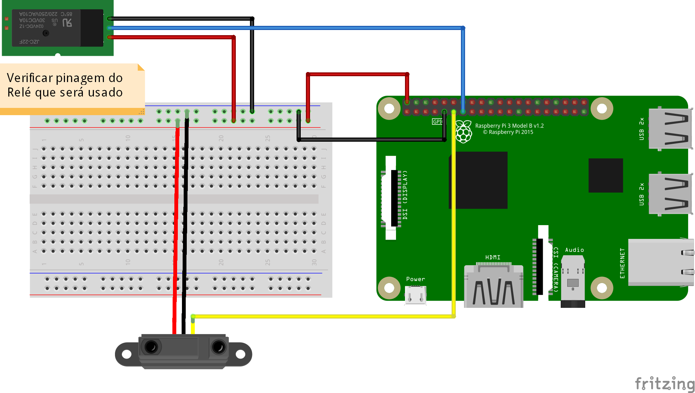

# Corona Gel Totem

Aplicação em Java/Swing para um Totem sobre COVID-19 executado no Raspberry Pi 3B

## Raspbian

### Instalação do Raspbian

Primeiro, baixe o ISO, do sistema operacional Raspbian que você instalará. Isso pode ser [baixado aqui](https://downloads.raspberrypi.org/raspbian_latest).

Em seguida, você precisará criar um sdcard inicializável. No Windows, use o Rufus, que pode ser [baixado aqui](https://github.com/pbatard/rufus/releases/download/v3.10/rufus-3.10p.exe).

Pegue um SD card classe 10, com 8 GB ou superior e execute o arquivo .exe do Rufus baixado. No Rufus, selecione o disco e a imagem. Depois clique em Iniciar.

Agora insira o SD Card no Raspberry Pi e execute o processo de instalação do Raspbian. Atualize o software quando pedir.

### Instalação do Java 8

Vamos instalar a versão 8 do Java LTS, para isso, abra o terminal (CTRL+ALT+T) e digite:

```bash
sudo apt update
sudo apt install openjdk-8-jdk
```

Verifique a instalação imprimindo a versão Java:

```bash
java -version
```

A saída deve ser algo como isto:

```bash
openjdk version "1.8.0_212"
OpenJDK Runtime Environment (build 1.8.0_212-8u212-b01-1+rpi1-b01)
OpenJDK Client VM (build 25.212-b01, mixed mode)
```

### Manter a tela sempre ativa

Para manter a tela sempre ativa, é necessário abrir o terminal (CTRL+ALT+T) e digitar o seguinte comando para abri o arquivo **lightdm.conf**

```bash
sudo nano /etc/lightdm/lightdm.conf
```

Com o arquivo aberto, procure esta linha

```bash
# xserver-command=X
```

E altere a linha para ficar desta forma

```bash
xserver-command=X -s 0 -dpms
```

Salve o arquivo usando CTRL+X - S - ENTER. Logo após, reinicie.

```bash
sudo reboot
```

### Rotacionar a tela (Opcional)

Abra o terminal (CTRL+ALT+T) e digite o seguinte comando para abri o arquivo **config.txt**

```bash
sudo nano /boot/config.txt
```

Adicione uma das seguintes linhas na parte inferior do arquivo:

```bash
display_rotate = 0
display_rotate = 1
display_rotate = 2
display_rotate = 3
```

0 é a configuração normal. 1 é 90 graus. 2 é 180 graus. 3 é 270 graus.

Salve o arquivo usando CTRL+X - S - ENTER. Logo após, reinicie.

```bash
reboot
```

## Raspberry Pi 3B

### Pinagem do Raspberry utilizando a biblioteca Pi4j

<p align="center">
    
</p>

### Configurações dos sensores

Pinos utilizados:

-   GPIO0: sensor de distância
-   GPIO2: atuador relé

<p align="center">
    
</p>

## Software

### Download do sistema

Para fazer download da última versão do sistema, iremos utilizar o git, abra o terminal (CTRL+ALT+T) e digite:

```bash
git clone https://github.com/kleberandrade/corona-gel
mkdir ~/Desktop/CoronaGel
cp -r corona-gel/dist/. ~/Desktop/CoronaGel/
```

### Atualiação do sistema (Opcional)

```bash
cd ~/coronal-gel
git fetch
git pull
sudo cp -r dist/. ~/Desktop/CoronaGel/
```

Agora é só reiniciar o sistema

```bash
sudo reboot
```

### Localização das imagens

Crie uma pasta com o nome **figures/slides** e **figures/sensors** dentro da pasta CoronaGel (pode utilizar o mouse para criar a pasta)

```bash
mkdir ~/Desktop/CoronaGel/figures
mkdir ~/Desktop/CoronaGel/figures/slides
mkdir ~/Desktop/CoronaGel/figures/sensors
```

Dentro da pasta slides você pode colocar quantas imagens quiser. Na pasta sensors você deve colocar somente uma imagem (imagem que vai aparecer quando a pessoa colocar a mão para pegar o alcool em gel).

### Auto inicialização do software

Para colocar o software para inicializar automaticamente, abra o terminal (CTRL+ALT+T)

```bash
sudo nano ~/Desktop/CoronaGel/coronagel.sh
```

Dentro do arquivo digite:

```bash
sudo java -jar ~/Desktop/CoronaGel/CoronaGel.jar
```

Salve o arquivo usando CTRL+X - S - ENTER. Ainda no terminal, vamos alterar a permissão do **coronagel.sh**

```bash
sudo chmod +x ~/Desktop/CoronaGel/coronagel.sh
```

Agora vamos abrir o arquivo **.bashrc**, para isso digite:

```bash
sudo nano ~/.bashrc
```

Ao abrir o arquivo, navega até a ultima linha e digite

```bash
bash ~/Desktop/CoronaGel/coronagel.sh
```

Salve o arquivo usando CTRL+X - S - ENTER. Ainda no terminar, digite

```bash
sudo nano /etc/xdg/lxsession/LXDE-pi/autostart
```

No final do arquivo digite

```bash
@lxterminal
```

Salve o arquivo usando CTRL+X - S - ENTER. Em seguida, reinicie

```bash
sudo reboot
```
