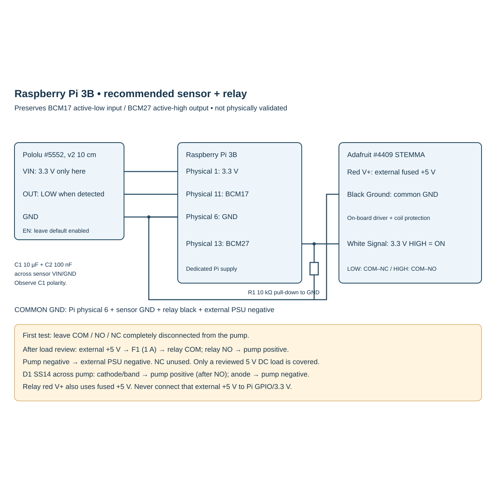

# Recommended relay assembly for Raspberry Pi 3B

This assembly preserves the original **digital proximity sensor + relay** behavior
and BCM17/27 wiring contract. Exact historical component models were not recorded;
the user authorized selecting documented compatible parts. These are recommendations,
not claims that the 2020 drawing identifies these same products. The old picture is
preserved in `../legacy`. No physical assembly has been tested in this environment.

## Parts

- Raspberry Pi 3B, separate appropriate Pi power supply, microSD and HDMI display.
- **Pololu Digital Distance Sensor v2, 10 cm, item #5552**. Use its VIN/GND/OUT pads
  and leave EN in the default enabled state. Use the digital-output version, not a
  pulse-width-output or analog distance sensor. Power it from the Pi's 3.3 V rail;
  OUT follows VIN when high, so powering it at 5 V would expose the GPIO to 5 V.
  It detects nearby objects with a LOW output; range depends on the target and light.
- **Adafruit STEMMA Non-Latching Mini Relay, item #4409**, plus JST-PH 3-pin cable.
  It has the transistor driver and coil protection on board and accepts a 3.3 V
  control signal. HIGH connects COM to NO; LOW returns COM to NC. This guide uses
  NO, so idle means load disconnected. Do not substitute an active-low board without
  reviewing software polarity and safe startup/shutdown states.
- Separate regulated 5 V supply with adequate current for the relay and chosen pump;
  a current-limited 5 V / 1 A bench supply is suitable for initial relay-only checks.
- Optional load for the final stage: a **5 V DC pump** with specified startup/stall
  current within the reviewed switching budget. For this reference, limit the pump
  stall current to 0.5 A and verify inductive-load derating against the actual relay
  and pump documentation. The relay's advertised resistive rating is not a motor
  rating. No particular pump or solvent/material compatibility is asserted.
- F1: 1 A fuse and holder sized for the reviewed assembly; R1: 10 kΩ pull-down,
  0.25 W; D1: SS14 flyback diode across the pump; C1: 10 µF / at least 6.3 V and C2:
  100 nF near the sensor supply; suitable insulated wiring and enclosure.

## Wiring, with every supply disconnected

[Connection list](connections.csv). Follow component labels, not assumed connector
order or the apparent color/order in the historical Fritzing illustration.

1. Pi physical **1 (3.3 V)** → sensor **VIN**.
2. Pi physical **6 (GND)** → sensor **GND**.
3. Sensor **OUT** → Pi physical **11 (BCM17)**.
4. Pi physical **13 (BCM27)** → relay **Signal**, white STEMMA wire.
5. Relay **V+**, red STEMMA wire → fused external **+5 V**.
6. Relay **Ground**, black STEMMA wire → external supply negative and Pi **GND**.
7. R1, 10 kΩ, joins BCM27/Signal to GND to hold the command low while unconfigured.
8. C1 and C2 join sensor VIN to GND; observe C1 polarity. They are not series parts.

Leave **COM/NO/NC without a pump connected for the first tests**. The three control
wires do not supply the pump through the GPIO. Do not connect external +5 V to Pi
3.3 V/GPIO pins. The Pi supply stays separate; only the ground reference is shared.

After successful unloaded tests and pump-specific electrical review:

- External +5 V → F1 → relay **COM**.
- Relay **NO** → pump positive. **NC stays unused**.
- Pump negative → external supply negative.
- D1 across the pump: **cathode/band to pump positive (after NO)**; anode to pump
  negative. The relay module's coil protection does not replace pump suppression.

Only low-voltage DC is covered. GPIO LOW, module power loss and an open NO contact
are the intended idle conditions, but boot transients, stuck/welded contacts, native
calls or process failures require verification on the actual hardware and a physical
power disconnect/independent cutoff where needed.

## Sources checked for this recommendation

- [Pololu #5552 documentation, pins, supply and active-low output](https://www.pololu.com/product/5552).
- [Adafruit #4409 product and load derating](https://www.adafruit.com/product/4409).
- [Adafruit relay control pins and HIGH/LOW contact states](https://learn.adafruit.com/adafruit-stemma-non-latching-mini-relay/pinouts).
- [Raspberry Pi GPIO electrical requirements](https://www.raspberrypi.com/documentation/computers/raspberry-pi.html).
- [Vishay SS14 diode data](https://www.vishay.com/docs/88746/ss12.pdf).

See [installation and staged testing](../../docs/RASPBERRY_PI.md#step-by-step-installation-and-relay-test).
